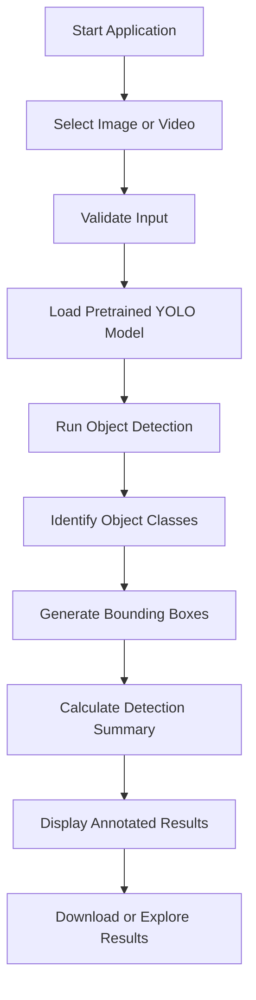
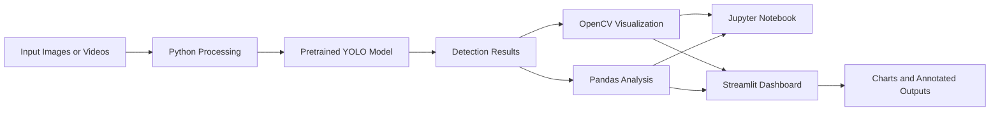

# 🚗 Tesla Autopilot Clone — AI-Powered Road Object Detection System

<p align="center">
  
  
  
  
  
</p>

<p align="center">
  <strong>An AI-powered computer vision project for detecting and visualizing road objects in images and videos.</strong>
</p>

<p align="center">
  Built with Python, YOLO, OpenCV, Jupyter Notebook, and Streamlit.
</p>

---

## 🌟 Overview

**Tesla Autopilot Clone — AI-Powered Road Object Detection System** is a computer vision project inspired by the object perception capabilities used in modern autonomous driving systems.

The project uses a pretrained YOLO object detection model to identify and locate objects in road scenes. It can display detected objects using bounding boxes, class labels, and confidence scores, helping users understand how computer vision systems interpret visual information.

The project combines an educational Jupyter Notebook with an interactive Streamlit web application, making it possible to explore the implementation, run object detection, visualize results, and interact with the system through a simple dashboard.

The main goal is to make AI-based object detection **accessible, understandable, interactive, and visually engaging**, even for beginners who are learning Python and machine learning.

Rather than building a complex autonomous driving system, this project focuses on one important component: visual object detection.

## 🎯 Project Objectives

- Understand the fundamentals of computer vision and object detection.
- Implement pretrained YOLO inference using Python.
- Detect and classify supported objects in road images.
- Visualize object locations with bounding boxes and labels.
- Display confidence scores for individual predictions.
- Summarize detection results using Pandas and charts.
- Process supported video files as an optional extension.
- Build an interactive web application using Streamlit.
- Demonstrate how a machine learning model can be integrated into a practical application.
- Provide a beginner-friendly implementation that can be studied, modified, and extended.

## 💡 Problem Statement

Road environments contain multiple objects, including vehicles, pedestrians, bicycles, and traffic-related elements. Identifying these objects manually can be time-consuming and inconsistent.

Computer vision provides a way to analyze visual data automatically and identify objects within images or video frames.

This project demonstrates a simple AI-powered approach that processes visual inputs, identifies supported object categories, and presents the results in an understandable visual format.

The project is intended for educational exploration of object detection and does not attempt to reproduce the complete perception, planning, or control systems used by commercial autonomous vehicles.

## ✨ Key Features

### 🤖 AI-Powered Object Detection

- Uses a pretrained YOLO model for object detection.
- Identifies supported object categories.
- Draws bounding boxes around detected objects.
- Displays class labels and confidence scores.
- Supports image-based inference without training a model from scratch.

### 🖼️ Image Detection

- Upload supported images for analysis.
- View original and annotated images.
- Explore detected object categories.
- Review confidence scores for individual detections.
- Generate a visual representation of the model's predictions.
- Download annotated images when the application supports this feature.

### 🎥 Video Detection

- Supports video-based object detection as an optional feature.
- Processes video frames using the detection model.
- Generates annotated video output when supported.
- Demonstrates how object detection can be applied to sequential visual data.
- Provides an opportunity to explore real-time computer vision concepts without controlling a real vehicle.

### 📊 Detection Analytics

- Count detected objects.
- Group detections by class.
- Display detection summaries in tables.
- Visualize object counts using charts.
- Inspect confidence scores.
- Measure inference time where practical.

### 📓 Jupyter Notebook

- Step-by-step implementation.
- Beginner-friendly Markdown explanations.
- Library imports and model initialization.
- Image preprocessing and inference.
- Result visualization.
- Data analysis and object count summaries.
- Optional video-processing demonstration.
- Discussion of model limitations.

### 🌐 Interactive Streamlit Dashboard

- Clean, modern automotive-inspired interface.
- Dark-themed visual design.
- Image upload and detection workflow.
- Detection settings, including a confidence threshold.
- Object summary metrics and charts.
- Annotated output visualization.
- Optional video-processing interface.
- Friendly error handling and usage instructions.

## 🧠 How It Works

The system follows a simple computer vision workflow.

1. **Input:** A user selects a sample image or uploads an image or supported video.
2. **Preprocessing:** The input is prepared for the detection model.
3. **Inference:** The pretrained YOLO model analyzes the image or video frames.
4. **Detection:** The model predicts object classes, locations, and confidence scores.
5. **Visualization:** Bounding boxes and labels are drawn on the visual input.
6. **Analysis:** Detected objects are counted and summarized.
7. **Output:** The application displays the results and provides supported download options.

### Workflow Diagram



## 🛠️ Technologies Used

| Technology | Purpose |
|---|---|
| Python | Main programming language |
| YOLO | Pretrained object detection |
| Ultralytics | Model loading and inference |
| OpenCV | Image and video processing |
| NumPy | Numerical operations |
| Pandas | Detection result analysis |
| Matplotlib | Data visualization in the notebook |
| Plotly | Interactive charts, if implemented |
| Jupyter Notebook | Step-by-step experimentation |
| Streamlit | Interactive web application |
| Pillow | Image loading and manipulation |

## 🏗️ Project Architecture

The project is divided into two primary components.

### 1. Jupyter Notebook — Model Implementation

The notebook demonstrates how the pretrained model is loaded and used to perform object detection.

It includes input preparation, inference, visualization, result analysis, and optional video processing.

This component is designed to make the underlying implementation understandable to students and beginners.

### 2. Streamlit — Interactive Application

The Streamlit application provides a user-friendly interface for interacting with the detection system.

Users can select inputs, configure detection settings, inspect annotated outputs, and explore object detection summaries without manually executing each model operation.

### Architecture Diagram



## 📁 Project Structure

The intended project structure is:

```text
tesla-autopilot-object-detection/
│
├── Tesla_Autopilot_Object_Detection.ipynb
├── app.py
├── requirements.txt
├── README.md
├── DATASET_INFO.md
├── .gitignore
│
├── data/
│   ├── sample_images/
│   └── sample_videos/
│
├── outputs/
│   ├── annotated_images/
│   ├── annotated_videos/
│   └── charts/
│
└── tests/
```

Some folders may be created automatically when the application runs. The final structure may differ slightly depending on the implementation.

## ⚙️ Installation and Setup

### Prerequisites

Install the following software:

- Python 3.10 or a compatible version supported by the selected dependencies.
- Jupyter Notebook or JupyterLab.
- A code editor such as Visual Studio Code.
- Git, if you plan to upload the project to GitHub.

A GPU is not required for the basic demonstration. Processing speed will depend on your hardware and input size.

### Step 1: Clone the Repository

```bash
git clone https://github.com/YOUR-USERNAME/YOUR-REPOSITORY.git
```

Replace the URL with your actual GitHub repository URL.

### Step 2: Enter the Project Directory

```bash
cd tesla-autopilot-object-detection
```

### Step 3: Create a Virtual Environment

```bash
python -m venv .venv
```

Activate it on Windows:

```bash
.venv\Scripts\activate
```

On macOS or Linux:

```bash
source .venv/bin/activate
```

### Step 4: Install Dependencies

```bash
python -m pip install --upgrade pip
pip install -r requirements.txt
```

The exact dependencies and versions should match the project's actual `requirements.txt`.

### Step 5: Open the Jupyter Notebook

```bash
jupyter notebook
```

Open:

`Tesla_Autopilot_Object_Detection.ipynb`

Run the cells in sequence to explore the model and its predictions.

### Step 6: Launch the Streamlit Application

```bash
streamlit run app.py
```

Streamlit will display a local URL in the terminal. Open that URL in your browser to access the dashboard.

## 🚀 How to Use the Application

### Image Detection

1. Launch the Streamlit application.
2. Open the image detection section.
3. Upload an image or select an available sample.
4. Adjust the confidence threshold if required.
5. Run object detection.
6. View the original and annotated images.
7. Explore object labels and confidence scores.
8. Review the object count chart and detection summary.
9. Download the annotated image if the feature is available.

### Video Detection

1. Open the video detection section.
2. Select a supported video file or bundled demonstration video.
3. Start video processing.
4. Wait for the model to analyze the frames.
5. Review the annotated output when processing completes.
6. Download the generated video if supported.

Video processing can take longer than image processing, especially on computers without GPU acceleration.

## 📊 Understanding Detection Results

### Bounding Boxes

Bounding boxes indicate the approximate locations of detected objects within an image.

They help users visualize where the model believes each object is located.

### Class Labels

A class label represents the category predicted by the model, such as a car, person, bus, or bicycle.

The available categories depend on the pretrained model and its training dataset.

### Confidence Scores

Confidence scores indicate the model's confidence in a particular prediction.

A higher score does not guarantee that the detection is correct. Scores should be interpreted alongside the visual results and known limitations of the model.

### Object Count

Object counts summarize the number of detections assigned to each category.

For example, a road image might contain several car detections and one pedestrian detection. These counts describe the model's predictions, not necessarily the true number of objects in the scene.

## 📈 Model Evaluation

The project focuses on pretrained-model inference and practical visualization.

Evaluation may include:

- Number of detected objects.
- Distribution of predicted object classes.
- Confidence score summaries.
- Inference time.
- Qualitative inspection of annotated images.
- Comparison of predictions under different confidence thresholds.

Formal metrics such as precision, recall, intersection over union (IoU), and mean average precision (mAP) require an appropriate labeled evaluation dataset and a compatible evaluation procedure.

These metrics should only be reported if they have actually been calculated.

A pretrained model's ability to produce predictions does not, by itself, establish the model's accuracy on a particular road-scene dataset.

## 📷 Project Screenshots

Add actual screenshots from your running application to the repository and update the image paths below.

### 1. Main Dashboard


*The main interface of the road object detection application.*

### 2. Image Detection Results


*An input image annotated with detected objects, bounding boxes, and class labels.*

### 3. Detection Analytics


*Object counts and visual summaries generated from actual detection results.*

### 4. Video Detection


*An example of the video detection interface and annotated output.*

> **Note:** Replace these screenshot paths with actual images captured from your application. If the screenshots have not yet been generated, these sections serve as placeholders.

## 🔍 Applications

This project demonstrates concepts that are relevant to:

- Computer vision education.
- Object detection experimentation.
- Road-scene analysis.
- Traffic object visualization.
- AI and machine learning demonstrations.
- Image and video analytics.
- Interactive machine learning interfaces.
- Introductory autonomous driving perception research.

These are potential application areas, not claims that the project is ready for deployment in real traffic environments.

## ⚠️ Limitations

- The model may miss objects or incorrectly classify them.
- Performance can vary with lighting, image quality, object size, distance, and occlusion.
- A pretrained model may not perform equally well in every environment.
- Video processing speed depends on the computer's available resources.
- Confidence scores are not equivalent to verified accuracy.
- Sample images may not represent all road conditions.
- The project does not perform full autonomous driving.
- The system does not plan vehicle trajectories, control steering, or operate vehicle brakes.
- It is not designed or validated for safety-critical use.

## 🔮 Future Enhancements

Possible improvements include:

- Testing on a larger labeled road-scene dataset.
- Evaluating precision, recall, and mAP.
- Comparing different lightweight detection models.
- Adding frame-by-frame video analytics.
- Improving performance for distant objects.
- Adding more detailed detection summaries.
- Recording inference statistics across multiple images.
- Improving dashboard accessibility and responsiveness.
- Supporting additional model configurations.
- Exploring object tracking across video frames.
- Adding lane detection as a separate educational module.
- Investigating traffic sign recognition with an appropriate model.
- Deploying the application to a suitable hosting platform.

Future features should be added incrementally to preserve the project's simplicity and reliability.

## 🧪 Troubleshooting

### Model Download Fails

The pretrained model may require an internet connection the first time it is loaded.

Check your network connection and the model library's supported download method. If downloading is blocked, use a compatible model file obtained from a trusted source.

### Module Not Found

Install the project's dependencies in the same Python environment used to run the notebook or Streamlit.

```bash
pip install -r requirements.txt
```

### Streamlit Command Not Found

Verify that the virtual environment is activated, then run:

```bash
python -m streamlit run app.py
```

### Notebook Uses the Wrong Python Environment

Select the correct Jupyter kernel associated with the project's environment.

### Video Processing Is Slow

Try a shorter video, lower-resolution input, or fewer processed frames if these options are implemented.

### No Objects Are Detected

Try another sample image, check the confidence threshold, and verify that the selected model supports the object categories present in the image.

## 📚 Learning Outcomes

By studying and running this project, learners can gain practical exposure to:

- Python-based computer vision.
- Pretrained deep learning models.
- Object detection inference.
- Image and video processing.
- Bounding-box visualization.
- Confidence score interpretation.
- Data analysis with Pandas.
- Chart generation.
- Jupyter Notebook workflows.
- Streamlit application development.
- Basic model evaluation concepts.
- Software testing and project documentation.
- Git and GitHub project organization.

## 🎓 Project Information

**Project Name:** Tesla Autopilot Clone — AI-Powered Road Object Detection System

**Project Domain:** Artificial Intelligence and Computer Vision

**Implementation:** Python, YOLO, OpenCV, Jupyter Notebook, and Streamlit

**Project Type:** Educational AI/ML Project

**Intended Audience:** Students, beginners in computer vision, and machine learning enthusiasts

## 🙌 Acknowledgements

Thanks to the developers and maintainers of the open-source Python ecosystem, Ultralytics, OpenCV, Jupyter, and Streamlit for providing tools that make computer vision experimentation and interactive application development accessible.

Please consult the applicable licenses and attribution requirements for the libraries, pretrained model weights, and sample datasets used in the final implementation.

## 🔐 Safety and Disclaimer

This project is an independent educational prototype inspired by autonomous driving perception concepts.

It is not affiliated with, endorsed by, or developed by Tesla, Inc. The project does not reproduce Tesla's proprietary Autopilot technology.

It is not intended for actual vehicle control, public-road deployment, or safety-critical decision-making. All outputs should be treated as experimental model predictions.

## 📄 License

If you choose to distribute this project, add a license appropriate for your code and verify that the licenses of all included models, datasets, and other assets permit your intended use.

For example, you may select the MIT License for your own code if that is suitable, while separately respecting third-party licenses.

---

<p align="center">
  <strong>🚗 Exploring the road ahead, one detection at a time.</strong>
</p>

<p align="center">
  Built with Python, Computer Vision, and a passion for AI. 💙
</p>
