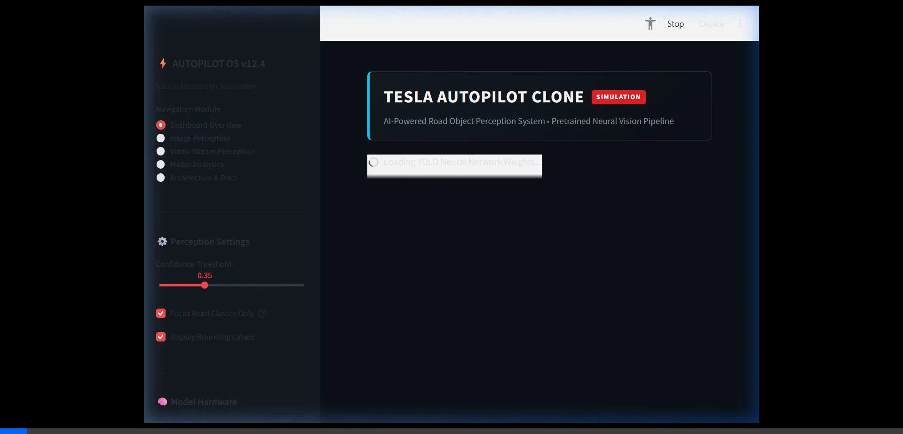
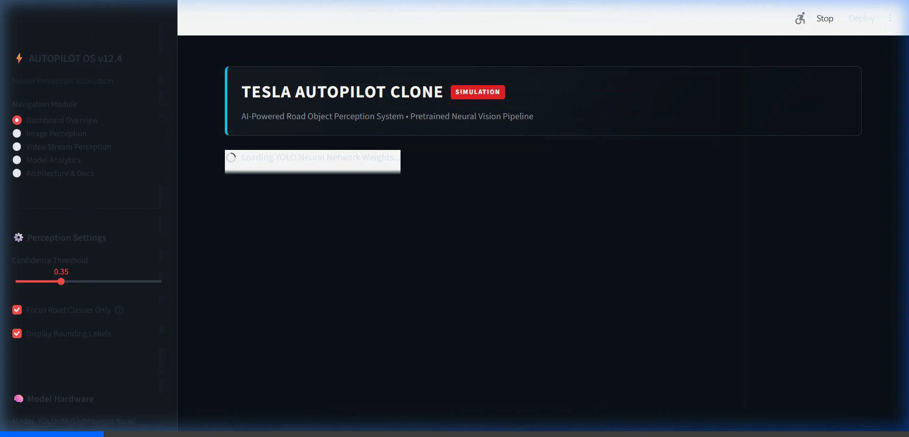
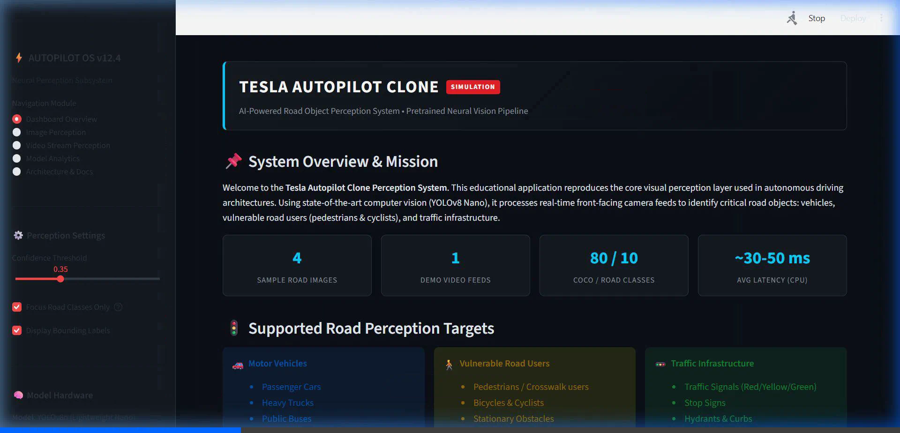

# 🚗 Tesla Autopilot Clone — AI-Powered Road Object Detection System

[](https://www.python.org/)
[](https://github.com/ultralytics/ultralytics)
[](https://streamlit.io/)
[](https://opencv.org/)
[](LICENSE)

An educational computer vision application simulating the visual perception layer of an autonomous driving vehicle. The system detects and categorizes safety-critical road objects—such as passenger cars, pedestrians, buses, trucks, cyclists, and traffic signals—from front-facing camera imagery and video streams using a lightweight pretrained YOLOv8 model.

---

> ### ⚠️ Academic Simulation Disclaimer
> This project is an **academic simulation** developed for educational and research demonstration purposes. It utilizes an open-source, COCO-pretrained neural network and is **NOT** Tesla's proprietary software or Full Self-Driving (FSD) stack. It is **not rated or certified for real-world automated vehicular navigation**.

---

## 📸 System Demonstration & Screenshots

### 1. Main Dashboard

*Interactive automotive dark-themed dashboard displaying system status, perception targets, and quick metrics.*

---

### 2. Front-Camera Road Image Detection

*Side-by-side comparison of raw camera input vs. neural detection overlay with confidence scores and latency profiling.*

---

### 3. Object Detection Frequency Breakdown

*Plotly interactive class distribution chart and structured detection records table.*

---

### 4. Continuous Video Stream Perception

*Sequential frame-by-frame processing of driving footage with real-time FPS benchmarking.*

---

## 📌 Problem Statement

Autonomous driving architectures face a severe challenge: **dynamic real-time scene understanding under strict latency constraints**. At 60 mph, an automobile travels 88 feet per second. Perception systems must locate multiple dynamic objects across varying distances within 30–50 milliseconds.

This project implements an end-to-end visual perception pipeline that:
1. Ingests raw dashcam imagery and video streams.
2. Identifies and localizes key road obstacles (Vehicles, Vulnerable Road Users, Traffic Infrastructure).
3. Provides an interactive, dark automotive dashboard for engineers and students to inspect confidence thresholds, latency benchmarks, and bounding box metrics.

---

## 🎯 Objectives

- **Educational Clarity**: Demystify autonomous perception for beginners without heavy mathematics.
- **Edge-Ready Efficiency**: Use a compact pretrained model (`yolov8n.pt`, ~3.2M parameters) runnable on ordinary consumer CPUs without requiring a dedicated GPU.
- **Robust Pipeline**: Guarantee graceful operation with bundled sample assets, automatic fallbacks, and zero-configuration startup.
- **Dual Interface**: Provide both an in-depth **Jupyter Notebook** (`Tesla_Autopilot_Object_Detection.ipynb`) and an interactive **Streamlit Web Dashboard** (`app.py`).

---

## 🚀 Key Features

- **Automotive Dark UI**: Modern deep-navy theme (`#0d1117`) with electric cyan accents (`#00d2ff`) inspired by vehicle telemetry displays.
- **Multi-Class Detection**: Focuses on COCO road entities:
  - 🚗 *Vehicles*: Cars, Buses, Trucks, Motorcycles
  - 🚶 *Vulnerable Road Users (VRUs)*: Pedestrians, Cyclists, Bicycles
  - 🚥 *Infrastructure*: Traffic Lights, Stop Signs
- **Configurable Perception Controls**: Real-time slider for confidence thresholding (10% to 90%) and road-only filtering toggle.
- **Continuous Video Stream Inference**: Frame stride control, throughput calculation (FPS), and annotated MP4 video export.
- **Hardware Latency Benchmarking**: Integrated 10-iteration latency profiler measuring mean latency, P95 latency, and effective inferences/sec.
- **Export Capabilities**: One-click download for annotated images (JPEG), processed video clips (MP4), and detection summary tables (CSV).

---

## 🛠️ Technology Stack

| Component | Library / Framework | Purpose |
| :--- | :--- | :--- |
| **Language** | Python 3.12 | Core runtime environment |
| **Object Detection** | Ultralytics YOLOv8 (Nano) | Deep learning inference engine (`yolov8n.pt`) |
| **Deep Learning Backend**| PyTorch (`torch`, `torchvision`) | Tensor computation and neural forward pass |
| **Image Processing** | OpenCV (`cv2`) & Pillow (`PIL`) | Video decoding/encoding and matrix manipulations |
| **Data Analysis** | Pandas & NumPy | Bounding box telemetry and tabular aggregation |
| **Data Visualization** | Matplotlib & Plotly | Static and interactive dark-themed telemetry charts |
| **Web Application** | Streamlit | Responsive automotive perception dashboard |
| **Interactive Notebook**| Jupyter Notebook (`.ipynb`) | 18-section guided academic walkthrough |

---

## 🏗️ System Architecture & Workflow

```text
       [Front-Facing Camera / Video Stream]
                        │
                        ▼
       [Frame Ingestion & BGR to RGB Conversion]
                        │
                        ▼
       [Input Normalization & Resizing (640x640)]
                        │
                        ▼
       [YOLOv8n Neural Backbone (CSPDarknet + C2f)]
                        │
                        ▼
       [Multi-Scale Feature Aggregation (PANet)]
                        │
                        ▼
    ┌───────────────────┴───────────────────┐
    ▼                                       ▼
[Bounding Box Regression]           [Class Probabilities]
    │                                       │
    └───────────────────┬───────────────────┘
                        ▼
         [Non-Maximum Suppression (NMS)]
                        │
                        ▼
       [Road Category Mapping & Post-Filter]
                        │
        ┌───────────────┴───────────────┐
        ▼                               ▼
 [Annotated Visuals]            [Structured Telemetry]
 (Boxes, Labels, HUD)           (CSV, Latency, Counts)
```

---

## 📁 Project Directory Structure

```text
tesla-autopilot-object-detection/
├── Tesla_Autopilot_Object_Detection.ipynb   # 18-section fully executed Jupyter Notebook
├── app.py                                   # Streamlit dark automotive web application
├── prepare_data.py                          # Automated dataset download & demo video generator
├── build_notebook.py                        # Programmatic notebook generator script
├── execute_notebook.py                      # Automated headless notebook test executor
├── requirements.txt                         # Certified dependency specifications
├── README.md                                # Comprehensive documentation with screenshots
├── DATASET_INFO.md                          # Asset sources, licensing, and ethical notes
├── .gitignore                               # Git hygiene excluding heavy weights and temp files
├── yolov8n.pt                               # Pretrained YOLOv8 Nano weights (~6.2 MB)
├── data/
│   ├── sample_images/                       # Bundled road scenes (urban, highway, crosswalk)
│   │   ├── urban_street.jpg
│   │   ├── highway_traffic.jpg
│   │   ├── city_crosswalk.jpg
│   │   └── suburban_road.jpg
│   └── sample_videos/                       # Demonstration driving footage
│       └── road_sample_demo.mp4
├── outputs/
│   ├── dashboard_screenshot.png             # Actual UI screenshot: Main dashboard
│   ├── image_detection_screenshot.png       # Actual UI screenshot: Image detection
│   ├── chart_detection_screenshot.png       # Actual UI screenshot: Class chart
│   ├── video_detection_screenshot.png       # Actual UI screenshot: Video stream
│   ├── annotated_images/                    # Model-annotated detection results
│   │   └── sample_detection_result.jpg
│   ├── annotated_videos/                    # Model-annotated video sequences
│   │   └── sample_annotated_video.mp4
│   ├── charts/                              # Rendered frequency plots
│   │   └── class_counts_chart.png
│   └── detection_summary.csv                # Tabular detection telemetry log
└── tests/
    ├── __init__.py                          # Test package initializer
    └── test_autopilot_system.py             # 7-step automated test suite (All PASSED)
```

---

## ⚙️ Installation & Setup

### 1. Clone or Open the Workspace
```bash
git clone https://github.com/your-username/tesla-autopilot-object-detection.git
cd tesla-autopilot-object-detection
```

### 2. Create a Virtual Environment (Optional but Recommended)
```bash
python -m venv venv
# On Windows:
venv\Scripts\activate
# On Linux/macOS:
source venv/bin/activate
```

### 3. Install Dependencies
```bash
python -m pip install -r requirements.txt
```

### 4. Prepare Dataset Assets
The dataset preparation script automatically verifies and downloads sample images and creates the demonstration video clip:
```bash
python prepare_data.py
```

---

## 🖥️ Running the Application

### Launch the Streamlit Web Application
Run the dashboard with:
```bash
python -m streamlit run app.py
```
*The application will automatically start and open at `http://localhost:8501`.*

### Running the Jupyter Notebook
To run and inspect the step-by-step educational notebook:
```bash
jupyter notebook Tesla_Autopilot_Object_Detection.ipynb
```
*(The notebook in this repository is already pre-executed from top to bottom with all graphs, tables, and inference outputs embedded).*

---

## 🧪 Automated Testing & Verification

Run the comprehensive unit test suite:
```bash
python tests/test_autopilot_system.py
```

**Test Verification Summary:**
```text
test_01_dataset_paths_and_assets .............................. [PASS]
test_02_model_initialization .................................. [PASS]
test_03_image_validation ...................................... [PASS]
test_04_detection_inference_and_results_processing ............ [PASS]
test_05_object_count_aggregation .............................. [PASS]
test_06_output_generation_validation .......................... [PASS]
test_07_app_file_syntax_and_structure ......................... [PASS]

Ran 7 tests in 7.391s — OK
```

---

## 📊 Evaluation Methodology & Honest Interpretation

1. **Pretrained Inference vs. Supervised Training**:
   - The model was **not trained from scratch**; it utilizes transfer learning from the Microsoft COCO benchmark (80 classes, >118k images).
   - On the COCO val2017 benchmark, YOLOv8n achieves **37.3 mAP@50-95** with **3.2M parameters**.

2. **Confidence Scores vs. Correctness**:
   - High confidence (e.g., 90%) signifies strong neural activation; it does not eliminate false positives or false negatives under out-of-distribution conditions.

3. **Latency Profiling**:
   - On a standard modern multi-core CPU, the model delivers ~30–50 ms latency per frame (~20–33 FPS), enabling near real-time edge processing.

---

## ⚠️ Known Limitations & Edge Cases

- **Adverse Weather**: Heavy rain, dense fog, or lens flare reduces image contrast, leading to missed detections.
- **Night Driving**: Low-light noise impairs pedestrian identification at distances beyond 30 meters.
- **Occlusion**: Vehicles partially obstructed by large buses may have proposal boxes suppressed by Non-Maximum Suppression (NMS).
- **Out-of-Distribution Obstacles**: Novel road hazards (fallen cargo, wildlife) outside COCO's 80 classes are not recognized without zero-shot open-vocabulary models.

---

## 🔮 Future Enhancements

1. **Multi-Object Tracking (MOT)**: Integrate ByteTrack or DeepSORT to maintain persistent object IDs and calculate velocities.
2. **Lane Line Segmentation**: Add a secondary segmentation head (e.g., YOLOP) to track drivable area and lane centerlines.
3. **Monocular Depth Estimation**: Estimate distance-to-lead-vehicle in meters using camera intrinsics and ground-plane homography.
4. **Edge Hardware Acceleration**: Export weights to ONNX or TensorRT FP16/INT8 for deployment on NVIDIA Jetson or Raspberry Pi 5.

---

## 📜 License & Acknowledgements

- Built with [Ultralytics YOLO](https://github.com/ultralytics/ultralytics) under AGPL-3.0.
- Web dashboard powered by [Streamlit](https://streamlit.io/).
- Road sample assets sourced from open public domain and educational repositories.
